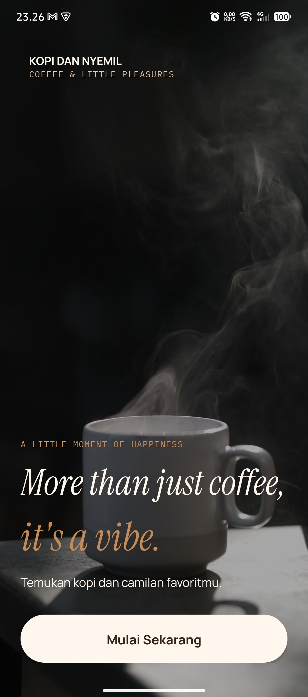
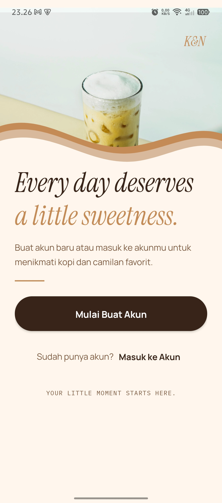
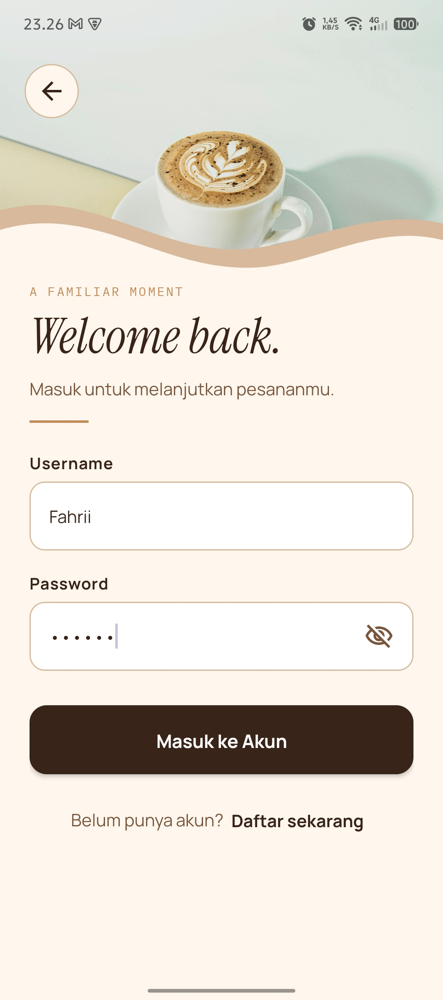
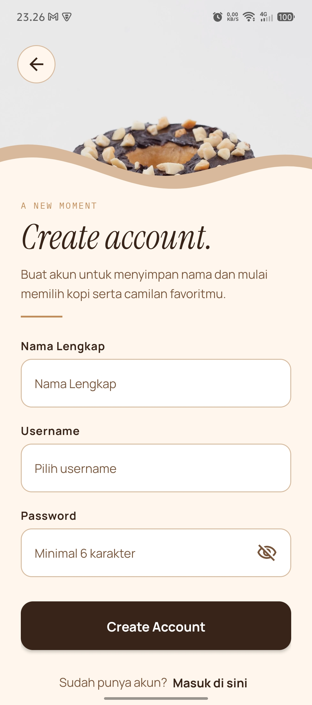
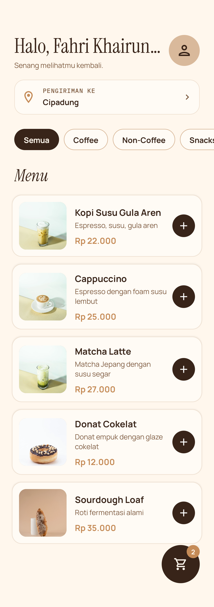
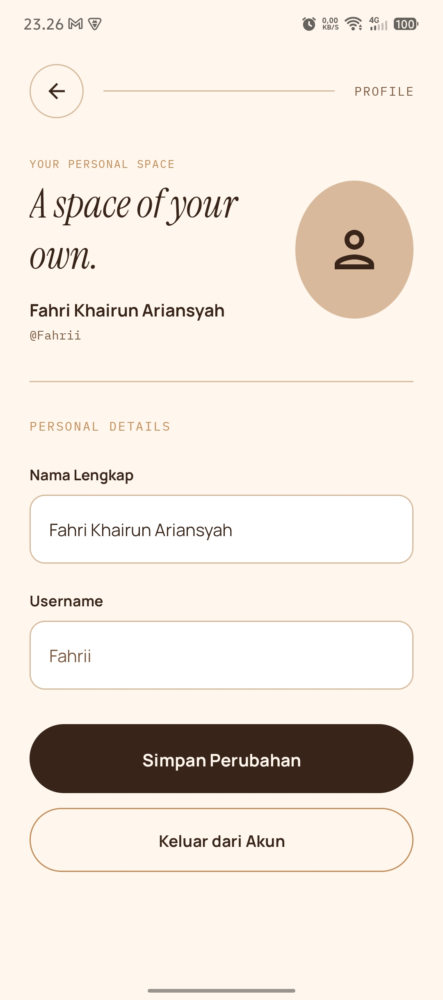
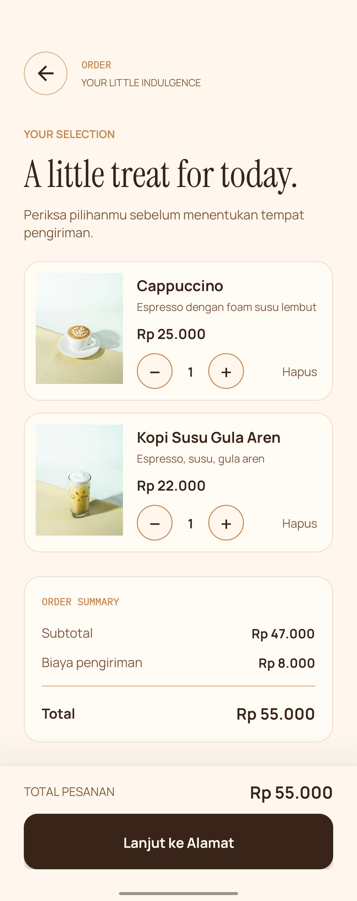
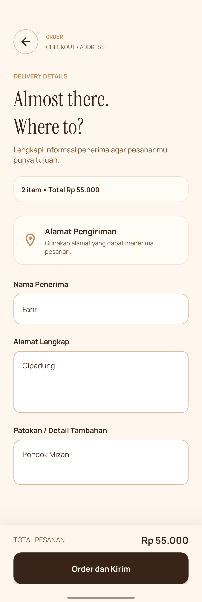
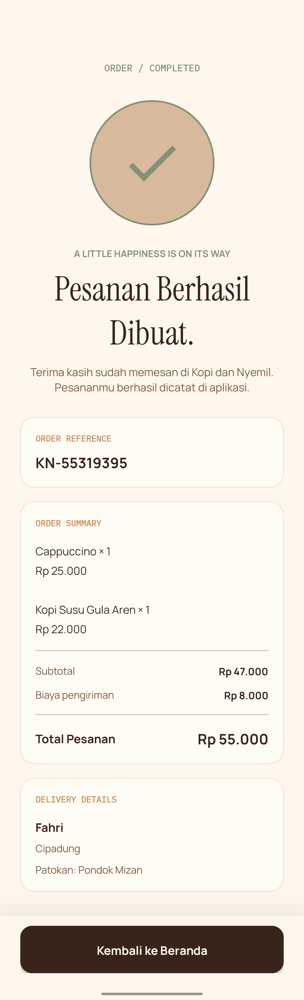

# Kopi dan Nyemil

Aplikasi Android pemesanan kopi dan camilan yang dibuat sebagai proyek pembelajaran **Pemrograman Mobile**. Aplikasi ini mengusung identitas visual **Liquid Espresso** dengan komposisi editorial, fotografi produk, tipografi ekspresif, dan interaksi yang terarah.

## Daftar Isi

- [Tentang Aplikasi](#tentang-aplikasi)
- [Fitur](#fitur)
- [Alur Aplikasi](#alur-aplikasi)
- [Teknologi](#teknologi)
- [Identitas Visual](#identitas-visual)
- [Menjalankan Proyek](#menjalankan-proyek)
- [Penyimpanan Data](#penyimpanan-data)
- [Batasan](#batasan)
- [Struktur Proyek](#struktur-proyek)
- [Pengujian](#pengujian)
- [Screenshot](#screenshot)
- [Kredit Aset](#kredit-aset)

## Tentang Aplikasi

**Kopi dan Nyemil** merupakan aplikasi simulasi pemesanan kopi dan camilan untuk perangkat Android. Pengguna dapat membuat akun lokal, masuk, melihat katalog produk, menambahkan produk ke keranjang, mengatur kuantitas, mengisi alamat pengiriman, dan melihat konfirmasi pesanan.

Aplikasi dikembangkan menggunakan Kotlin dan XML dengan Android Views. Seluruh data aplikasi disimpan secara lokal pada perangkat sehingga proyek ini tidak membutuhkan backend atau koneksi database.

## Fitur

- **Welcome dan autentikasi:** halaman Welcome, Sign Up, Register, dan Login.
- **Akun lokal:** registrasi, login, dukungan beberapa akun, dan logout.
- **Home:** greeting berdasarkan akun aktif, katalog produk, serta filter kategori.
- **Katalog produk:** Kopi Susu Gula Aren, Cappuccino, Matcha Latte, Donat Cokelat, dan Sourdough Loaf.
- **Keranjang:** menambahkan beberapa jenis produk, menambah atau mengurangi kuantitas, menghapus item, dan menghitung subtotal.
- **Alamat pengiriman:** menyimpan nama penerima, alamat lengkap, dan patokan secara lokal per akun.
- **Order summary:** menghitung subtotal, biaya pengiriman dummy, dan total pesanan.
- **Confirmation:** menampilkan nomor referensi lokal, ringkasan item, total, dan informasi penerima.
- **Profile:** melihat informasi akun, memperbarui nama, dan logout tanpa menghapus akun yang terdaftar.
- **Interaksi visual:** animasi penambahan produk ke keranjang, feedback badge, dan animasi pada interaksi keranjang yang sedang disempurnakan.

## Alur Aplikasi

```text
Welcome
  └── Sign Up
       ├── Register ──> Login
       └── Login ─────> Home
                         ├── Profile
                         ├── Order / Cart
                         │     └── Address
                         │           └── Confirmation
                         └── Delivery Address
                               └── Order / Address
```

Cart dan Address merupakan dua tahap dalam satu alur `OrderActivity`, bukan halaman keranjang yang terpisah.

## Teknologi

| Bagian | Teknologi |
|---|---|
| Bahasa | Kotlin |
| UI | XML dan Android Views |
| Minimum SDK | Android API 27 |
| Daftar produk | Kotlin data class dan katalog statis |
| Daftar item | RecyclerView dan adapter |
| Penyimpanan lokal | SharedPreferences |
| Data keranjang | JSON lokal di SharedPreferences |
| Format harga | NumberFormat dengan locale Indonesia |
| Animasi | Android Views Property Animation dan ValueAnimator |

Proyek ini tidak menggunakan Jetpack Compose, backend, Firebase, atau database eksternal.

## Identitas Visual

Arah desain aplikasi bernama **LIQUID ESPRESSO** dengan karakter hangat, editorial, organik, dan ekspresif.

| Token | Warna | Hex |
|---|---|---|
| Espresso | Cokelat gelap | `#382419` |
| Caramel | Karamel | `#C58B57` |
| Latte | Latte | `#D9B99B` |
| Oat Milk | Krem terang | `#FFF7ED` |
| Cocoa | Cokelat sekunder | `#79563B` |
| Sage | Hijau lembut | `#84917A` |

Typeface yang digunakan adalah Instrument Serif untuk headline, Manrope untuk antarmuka dan teks utama, serta IBM Plex Mono untuk label pendukung.

## Menjalankan Proyek

### Persyaratan

- Android Studio dengan dukungan proyek Android berbasis Gradle.
- Android SDK yang sesuai dengan konfigurasi proyek.
- Perangkat Android atau emulator dengan API 27 atau lebih baru.

### Clone repository

```bash
git clone https://github.com/Kxrumii/KopiDanNyemil.git
cd KopiDanNyemil
```

### Buka dan jalankan

1. Buka folder proyek melalui Android Studio.
2. Tunggu proses Gradle Sync selesai.
3. Pilih emulator atau perangkat Android.
4. Jalankan konfigurasi aplikasi `app` melalui tombol **Run**.

Untuk memeriksa kompilasi melalui terminal Linux atau macOS:

```bash
./gradlew app:assembleDebug
```

Pada Windows:

```bat
gradlew.bat app:assembleDebug
```

## Penyimpanan Data

Aplikasi menggunakan `SharedPreferences` dengan nama penyimpanan `kopi_dan_nyemil`.

Data yang disimpan secara lokal meliputi:

- Informasi akun dan sesi pengguna aktif.
- Nama penerima dan alamat pengiriman per akun.
- Keranjang per akun, berupa ID produk dan kuantitas.
- Snapshot pesanan terakhir untuk ditampilkan pada halaman Confirmation.

Katalog produk bersifat statis dan didefinisikan di dalam source code. Harga produk disimpan sebagai nilai numerik dan diformat ke Rupiah saat ditampilkan.

## Batasan

Aplikasi ini merupakan prototipe pembelajaran dengan data lokal. Fitur berikut **belum tersedia**:

- Autentikasi dan sinkronisasi akun melalui server.
- Database online atau cloud backup.
- Payment gateway dan pembayaran sungguhan.
- Integrasi kurir, estimasi pengiriman, dan pelacakan pesanan.
- Peta, geocoding, atau validasi alamat otomatis.
- Riwayat pesanan multi-order yang tersimpan sebagai daftar permanen.
- Pengelolaan produk melalui panel admin.

Nomor pesanan pada halaman Confirmation merupakan nomor referensi lokal, bukan nomor transaksi dari layanan eksternal.

**Catatan keamanan:** prototipe ini menyimpan kredensial akun secara lokal menggunakan SharedPreferences. Penyimpanan password seperti ini tidak cocok untuk aplikasi produksi dan tidak boleh digunakan untuk menangani akun atau informasi sensitif sungguhan.

## Struktur Proyek

Struktur inti source code yang digunakan:

```text
app/src/main/
├── java/lat/pam/kopidannyemil/
│   ├── adapter/
│   │   ├── CartAdapter.kt
│   │   └── ProductAdapter.kt
│   ├── data/
│   │   ├── CartEntry.kt
│   │   ├── CartItem.kt
│   │   ├── CartManager.kt
│   │   ├── Product.kt
│   │   └── ProductCatalog.kt
│   ├── util/
│   │   └── PriceFormatter.kt
│   ├── MainActivity.kt
│   ├── SignUpActivity.kt
│   ├── RegisterActivity.kt
│   ├── LoginActivity.kt
│   ├── HomeActivity.kt
│   ├── ProfileActivity.kt
│   ├── OrderActivity.kt
│   └── ConfirmationActivity.kt
└── res/
    ├── drawable/
    ├── drawable-nodpi/
    ├── font/
    ├── layout/
    └── values/
```

Struktur di atas menampilkan bagian utama proyek; file resource dan konfigurasi lainnya tidak ditampilkan seluruhnya.

## Pengujian

Alur fungsional utama telah diuji secara manual pada lingkungan pengembangan, termasuk autentikasi, navigasi, pengelolaan keranjang, penyimpanan alamat, checkout lokal, dan konfirmasi pesanan.

Build debug dapat diperiksa menggunakan:

```bash
./gradlew app:assembleDebug
```

Pengujian visual akhir tetap perlu dilakukan pada perangkat dengan ukuran layar dan versi Android yang berbeda. Animasi juga perlu ditinjau dari sisi kelancaran, konsistensi, dan aksesibilitas.

## Screenshot

Berikut adalah pratinjau antarmuka aplikasi Kopi dan Nyemil:

| Welcome | Sign Up | Login |
|:---:|:---:|:---:|
|  |  |  |

| Register | Home | Profile |
|:---:|:---:|:---:|
|  |  |  |

| Order / Cart | Address | Confirmation |
|:---:|:---:|:---:|
|  |  |  |

## Kredit Aset

Aplikasi menggunakan foto produk, ikon, ilustrasi, dan typeface lokal di dalam resource Android.

Lengkapi bagian ini sebelum publikasi repository dengan informasi sumber aset yang benar, termasuk halaman sumber, nama kreator/fotografer, dan ketentuan lisensi bila berlaku. Jangan mencantumkan sumber atau lisensi yang belum diverifikasi.

---

Dibuat sebagai proyek pembelajaran Android Development menggunakan Kotlin dan XML / Android Views.
